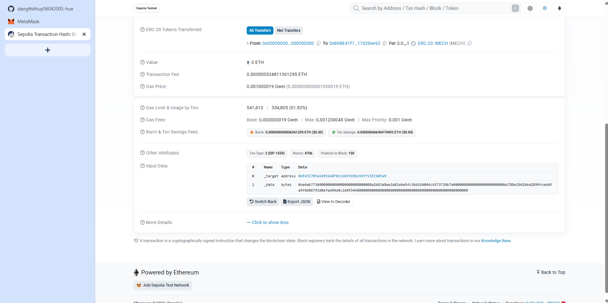
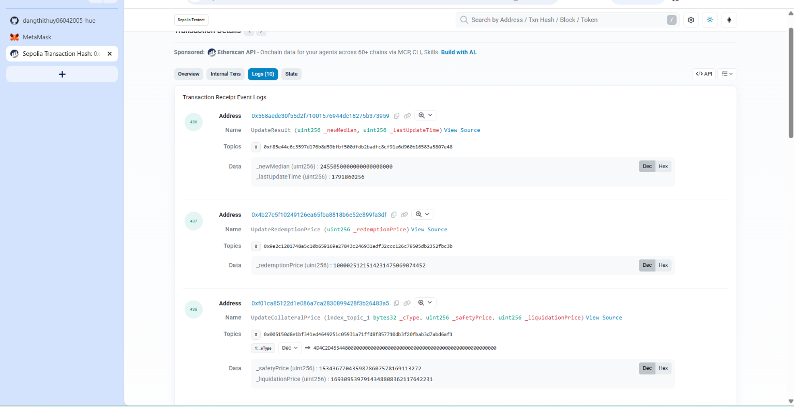

# Báo cáo thực hành Lab 05: Ethereum accounts, gas & the EVM
# Lab 05 Report: Ethereum accounts, gas & the EVM

- **Họ và tên / Student Name:** Đặng Thị Thùy - MSSV: 23071106
- **Môn học / Course:** Công nghệ Blockchain / Blockchain Technology
- **Mạng thực hành / Networks:** TrustKeys L1 testnet (ChainID: 11968) & Sepolia testnet

---

## Lab 5.1 — Add TrustKeys L1 to MetaMask

- **Địa chỉ ví / Wallet Address:** `0x34A07f3a288720977823A6694280620Afb60ec63`
- **Mạng đã thêm / Network Name:** TrustKeys L1 testnet
- **RPC URL:** `https://l1testnet.trustkeys.network`
- **Chain ID:** `11968`
- **Ký hiệu tiền tệ / Currency Symbol:** `TRUSTK`

### Q1 / Câu hỏi 1:
> **EN:** Adding a network only changes the RPC endpoint + chainId — your private key never leaves the device. Why is chainId *also* part of every signed transaction (recall EIP-155, Session 3)?  
> **VI:** Thêm mạng chỉ đổi endpoint RPC + chainId — khóa bí mật không rời thiết bị. Vì sao chainId *cũng* nằm trong mọi giao dịch được ký (nhớ EIP-155, Buổi 3)?

**Trả lời / Answer:**

* **English:**  
  `ChainID` is included in the signed transaction payload (pursuant to EIP-155) to prevent **replay attacks**. Because the exact same private key generates identical public addresses across multiple EVM-compatible networks (such as testnet and mainnet), an attacker could take a valid transaction signed on a testnet and replay/broadcast it onto the mainnet without authorization. Embedding `ChainID` into the transaction hash before signing cryptographically binds that signature exclusively to one specific blockchain network.

* **Tiếng Việt:**  
  `ChainID` bắt buộc phải là một phần trong dữ liệu được ký của mọi giao dịch (theo chuẩn EIP-155) để ngăn chặn cuộc tấn công phát lại (**Replay Attack**). Nếu không có `ChainID`, do cùng một private key sẽ tạo ra cùng một địa chỉ công khai trên nhiều mạng EVM khác nhau (ví dụ testnet và mainnet), một kẻ tấn công có thể lấy nguyên văn giao dịch đã ký hợp lệ từ mạng thử nghiệm và phát lại lên mạng chính (mainnet) để chiếm đoạt tài sản. Việc đưa `ChainID` vào hàm băm trước khi ký số sẽ khóa chặt chữ ký đó chỉ có hiệu lực duy nhất trên một mạng lưới cụ thể.

---

## Lab 5.2 — Read the chain with web3.py

Kết quả thực thi script `fee_history.py` đọc từ chuỗi TrustKeys L1 / Execution output of `fee_history.py` on TrustKeys L1:

```text
Connected to TrustKeys L1  chainId=11968  head block=717634
[eth_getBlockByNumber latest]
  number        = 717634
  gasLimit      = 30,000,000
  gasUsed       = 21,000  (0.07% full)
  baseFeePerGas = 8  (0.000000008 gwei (8 wei))  <- EIP-1559 active
  #txs          = 1

[eth_feeHistory]  last 20 blocks (base fee series)
  block      baseFee(gwei)   gasUsedRatio    tip p50 (gwei) 
  717615     0.0000          0.39%           2.0000         
  717616     0.0000          0.17%           2.0000         
  717617     0.0000          0.09%           1.5000         
  717618     0.0000          1.15%           2.0000         
  717619     0.0000          0.08%           2.0000         
  717620     0.0000          0.07%           2.0000         
  717621     0.0000          0.07%           2.0000         
  717622     0.0000          0.07%           2.0000         
  717623     0.0000          0.07%           2.0000         
  717624     0.0000          0.07%           2.0000         
  717625     0.0000          0.07%           2.0000         
  717626     0.0000          0.07%           2.0000         
  717627     0.0000          2.90%           2.0000         
  717628     0.0000          0.38%           2.0000         
  717629     0.0000          3.47%           2.0000         
  717630     0.0000          0.17%           2.0000         
  717631     0.0000          0.12%           2.0000         
  717632     0.0000          0.07%           2.0000         
  717633     0.0000          0.07%           2.0000         
  717634     0.0000          0.07%           2.0000         
  next block's projected baseFee = 0.000000008 gwei (8 wei)
  average gasUsedRatio over window = 0.48%  -> chain is quiet
```

### Q2 / Câu hỏi 2:
> **EN:** On TrustKeys L1 right now the base fee is only a handful of wei (well below 1 gwei) and `gasUsedRatio` is ~2%. Using the EIP-1559 rule (target 15M / cap 30M gas; ±12.5% per block), explain *why* the base fee stays at the floor.  
> **VI:** Base fee hiện chỉ vài wei (dưới 1 gwei), `gasUsedRatio` ~2%. Dùng quy tắc EIP-1559 (mục tiêu 15M / trần 30M gas; ±12.5%/block), giải thích *vì sao* base fee đứng ở đáy.

**Trả lời / Answer:**

* **English:**  
  Under the EIP-1559 mechanism, `baseFee` decreases automatically (by up to 12.5% per block) whenever actual block gas consumption (`gasUsed`) falls below the target capacity (target = 15M gas, representing 50% of the 30M gas cap). Since the TrustKeys L1 testnet currently experiences minimal traffic with `gasUsedRatio` lingering around 0.07% – 2% (drastically lower than the 50% target), EIP-1559 consistently reduces the base fee across successive blocks until it hits the chain's protocol-enforced minimum floor (8 wei), where it stays because it cannot drop any lower.

* **Tiếng Việt:**  
  Theo quy tắc EIP-1559, `baseFee` sẽ tự động giảm (tối đa 12.5% mỗi block) nếu lượng gas tiêu thụ thực tế nhỏ hơn mức mục tiêu (target là 15M gas, tương ứng 50% trần 30M gas). Vì mạng TrustKeys L1 testnet hiện tại rất ít giao dịch, tỷ lệ sử dụng `gasUsedRatio` chỉ dao động quanh mức 0.07% - 2% (thấp hơn rất nhiều so với ngưỡng 50%), nên thuật toán EIP-1559 liên tục giảm base fee qua từng block cho đến khi nó chạm mức sàn tối thiểu của mạng lưới (8 wei) và duy trì ở đó do không thể giảm thấp hơn giá trị đáy quy định.

### Q3 / Câu hỏi 3:
> **EN:** `eth_feeHistory` returns `baseFeePerGas` of length **N+1** but `gasUsedRatio` of length **N**. What is that extra element, and how would a wallet use it to set `maxFeePerGas`?  
> **VI:** `eth_feeHistory` trả `baseFeePerGas` dài **N+1** nhưng `gasUsedRatio` dài **N**. Phần tử dư là gì, và ví dùng nó để đặt `maxFeePerGas` thế nào?

**Trả lời / Answer:**

* **English:**  
  The extra (N+1)-th element in the `baseFeePerGas` array is the **projected base fee for the next upcoming block**. The node can calculate this exact value in advance because under EIP-1559, the next block's base fee is purely a deterministic mathematical function of the immediate predecessor's `gasUsed`. Wallets (such as MetaMask) take this projected base fee as a baseline, apply a safety buffer multiplier (e.g., 1.125x to 2x depending on congestion), and add the user's `maxPriorityFeePerGas` (tip) to calculate `maxFeePerGas`. This guarantees that the transaction remains eligible for inclusion even if the base fee rises in upcoming blocks.

* **Tiếng Việt:**  
  Phần tử dư thứ N+1 trong mảng `baseFeePerGas` chính là **dự báo giá trị base fee cho block tiếp theo** (next block's projected baseFee). Thuật toán có thể tính trước giá trị này chính xác 100% vì theo công thức EIP-1559, base fee của block tương lai chỉ phụ thuộc hoàn toàn vào `gasUsed` của block ngay liền trước. Các ví (như MetaMask) sử dụng giá trị base fee dự phóng này làm mốc cơ sở, sau đó nhân với một hệ số đệm an toàn (ví dụ x1.125 hoặc x2 tùy theo mức độ tắc nghẽn) rồi cộng thêm `maxPriorityFeePerGas` (tiền tip cho miner) để thiết lập `maxFeePerGas`. Việc này đảm bảo giao dịch vẫn được đưa vào các block tiếp theo ngay cả khi base fee đột ngột tăng lên do mạng bận rộn.

---

## Lab 5.3 — Send a type-2 tx and decompose the fee

- **Transaction Hash:** `0xb4757aaee194c6a04632323b0eca901be5516dd0c5ab44797e6caf1c3c23940c`
- **Block Number:** `717637`

Kết quả chạy script `decompose_fee.py` / Execution output of `decompose_fee.py`:

```text
=== LAB 5.3 - DECOMPOSE TYPE-2 TRANSACTION FEE ===
Tx Hash:           0xb4757aaee194c6a04632323b0eca901be5516dd0c5ab44797e6caf1c3c23940c
Block Number:      717637
Gas Used:          21,000
Base Fee per Gas:  8 wei (0.000000008 gwei)
Effective Price:   2,000,000,000 wei (2.000000000 gwei)
Max Fee per Gas:   2,000,000,000 wei
Max Priority Fee:  2,000,000,000 wei
--------------------------------------------------
Total Paid:        42000000000000 wei (0.000042000000000000 coin)
Burned:            168000 wei (0.000000000000168000 coin)  [leaves circulation]
Tip (Miner fee):   41999999832000 wei (0.000041999999832000 coin)  [to proposer]

Identity check:    paid == burned + tip ? -> True
Equation:          42000000000000 == 168000 + 41999999832000
```

### Q4 / Câu hỏi 4:
> **EN:** Your `effectiveGasPrice` equals `baseFee + min(maxPriorityFee, maxFee − baseFee)`. If you had raised your MetaMask *max base fee* setting but left the *priority fee* the same, would `effectiveGasPrice` change? Why / why not?  
> **VI:** Nếu bạn tăng *max base fee* trong MetaMask nhưng giữ nguyên *priority fee*, `effectiveGasPrice` có đổi không? Vì sao?

**Trả lời / Answer:**

* **English:**  
  The formula is `effectiveGasPrice = baseFee + min(maxPriorityFee, maxFee − baseFee)`. In a quiet network state where `baseFee` is negligible, the headroom `maxFee - baseFee` is significantly greater than `maxPriorityFee`. Hence, the `min()` term consistently evaluates to `maxPriorityFee`. Consequently, increasing the *max base fee* (`maxFee`) while leaving the *priority fee* (`maxPriorityFee`) constant will **not change** `effectiveGasPrice`, because the resulting price remains `baseFee + maxPriorityFee`.

* **Tiếng Việt:**  
  Công thức tính giá thực tế là: `effectiveGasPrice = baseFee + min(maxPriorityFee, maxFee − baseFee)`. Trong điều kiện mạng bình thường (base fee rất thấp), khoảng chênh lệch `maxFee - baseFee` lớn hơn rất nhiều so với `maxPriorityFee`. Do đó, hàm `min()` sẽ luôn chọn `maxPriorityFee`. Vì vậy, nếu bạn tăng *max base fee* (`maxFee`) nhưng giữ nguyên *priority fee* (`maxPriorityFee`), thì `effectiveGasPrice` **hoàn toàn không đổi** vì nó vẫn được tính bằng `baseFee + maxPriorityFee`.

### Q5 / Câu hỏi 5:
> **EN:** A simple transfer used exactly **21,000** gas. Where does that number come from, and why does even a *failed* transfer still cost you gas?  
> **VI:** Một giao dịch chuyển đơn giản dùng đúng **21.000** gas. Con số đó từ đâu ra, và vì sao một giao dịch *thất bại* vẫn tốn gas?

**Trả lời / Answer:**

* **English:**  
  - The **21,000 gas** is the protocol-defined intrinsic base gas cost for every standard transfer (native coin transfer between two EOAs). It covers baseline node workloads: elliptic curve signature verification, transaction nonce check, data format validation, and state update of account balances in the State Trie.
  - A failed transaction (e.g., reverted or out of gas) **still costs gas** because block proposers and validators already committed computation, CPU execution cycles, and bandwidth to process and validate the transaction up to the point of failure. Requiring payment for failed transactions also deters denial-of-service (DDoS) spam attacks that could otherwise flood the network for free.

* **Tiếng Việt:**  
  - Con số **21.000 gas** là chi phí cơ sở (intrinsic gas cost) được quy định cố định trong giao thức Ethereum cho mọi giao dịch chuẩn (chuyển token mạng giữa 2 tài khoản EOA). Chi phí này bù đắp cho công việc cơ bản của các node: xác thực chữ ký elliptic curve, kiểm tra nonce, định dạng giao dịch và cập nhật số dư của tài khoản gửi và nhận trong State Trie.
  - Một giao dịch thất bại (ví dụ: bị revert hoặc hết gas) **vẫn tốn gas** vì các validator/miner đã phải tiêu tốn tài nguyên phần cứng, chu kỳ CPU và băng thông mạng để đưa giao dịch vào block và chạy các chỉ lệnh cho tới điểm phát sinh lỗi. Quy định này cũng nhằm ngăn chặn các cuộc tấn công từ chối dịch vụ (DDoS spam) miễn phí vào mạng lưới.

---

## Lab 5.4 — Trace a contract interaction on Sepolia Etherscan

*(Đính kèm 2 ảnh chụp màn hình từ Sepolia Etherscan / Attached 2 screenshots from Sepolia Etherscan)*

### a) Ảnh chụp màn hình Input Data đã giải mã / Decoded Input Data Screenshot:


### b) Ảnh chụp màn hình tab Logs / Logs Tab Screenshot:


### Q6 / Câu hỏi 6:
> **EN:** The selector is `keccak256("transfer(address,uint256)")[:4]` = `0xa9059cbb`. Explain in two sentences how the EVM uses these 4 bytes to jump to the right function (the "dispatcher"), and why Etherscan needs the contract's **ABI** to decode the rest.  
> **VI:** Selector là 4 byte đầu của keccak của chữ ký hàm (`0xa9059cbb`). Giải thích trong 2 câu EVM dùng 4 byte này để nhảy tới đúng hàm (dispatcher) thế nào, và vì sao Etherscan cần **ABI** của hợp đồng để giải mã phần còn lại.

**Trả lời / Answer:**

* **English:**  
  1. The contract's EVM **runtime dispatcher** extracts the first 4 bytes of `calldata` and executes sequential checks (`DUP1`, `PUSH4 <selector>`, `EQ`) followed by `JUMPI`, jumping execution directly to the bytecode routine of the matching function.  
  2. Etherscan requires the contract's **ABI** because the rest of the calldata is merely contiguous raw hex bytes packed into 32-byte chunks; the ABI serves as the schema defining parameter names and types (e.g., `address`, `uint256`), enabling Etherscan to properly decode and deserialize the data into human-readable parameters.

* **Tiếng Việt:**  
  1. Khi nhận giao dịch, đoạn mã **dispatcher** trong hợp đồng sẽ trích xuất 4 byte đầu tiên của `calldata` và dùng một chuỗi các lệnh so sánh `DUP1`, `PUSH4 <selector>`, `EQ`, sau đó gọi `JUMPI` để nhảy thẳng đến vị trí bytecode thực thi của hàm tương ứng nếu trùng khớp.  
  2. Etherscan cần **ABI** vì phần dữ liệu tham số truyền vào chỉ là một chuỗi nhị phân hex thô được đóng gói theo từng khối 32 byte; ABI đóng vai trò như lược đồ định nghĩa kiểu dữ liệu (tên tham số, `address`, `uint256`), giúp Etherscan biết cách phân tách và ánh xạ chuỗi hex đó trở lại thành dữ liệu có ý nghĩa cho người dùng đọc.
